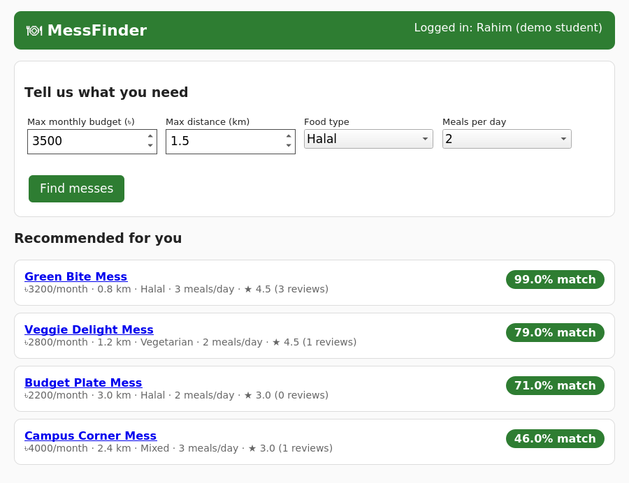
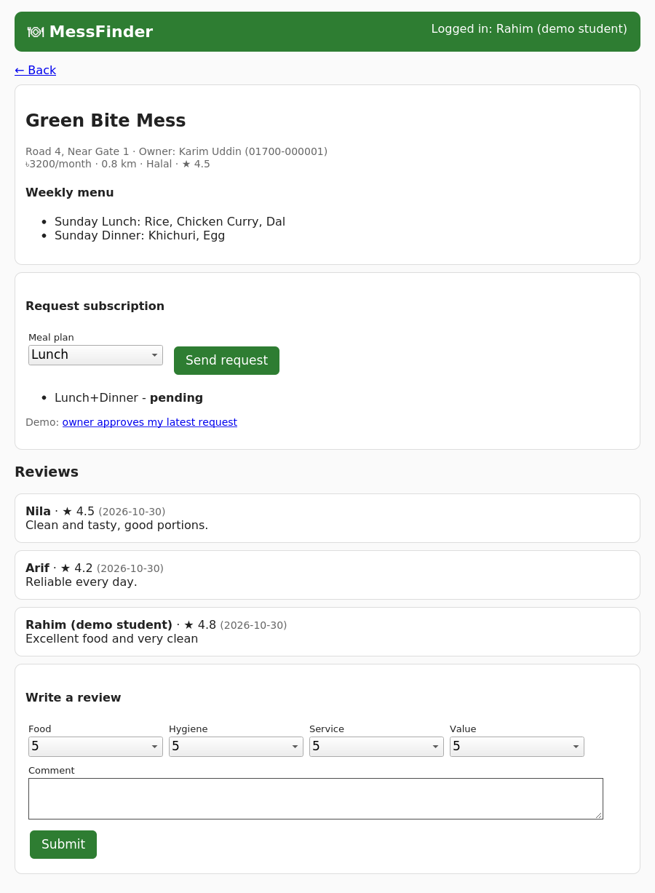

# 🍽 MessFinder — Smart Mess Recommendation Platform

> **Final Capstone Project – Part I: Proposal and Prototyping**
> Author: Ridhikanta Sarkar Sumit · ID: *IT24045* · Course: *SEPM*

Every year new students arrive on campus and struggle to find a mess (meal subscription service) that fits their budget, food habits and location. **MessFinder** lets a student enter preferences and instantly get a **ranked list of messes with a match score**, weekly menus, and reviews from current students. Mess owners manage listings and subscription requests; an admin verifies listings and moderates reviews.

## 📸 Screenshots
| Ranked recommendations | Mess details, menu, reviews |
|---|---|
|  |  |

## ✅ Assignment requirements checklist
| Requirement | Where |
|---|---|
| Own project idea | MessFinder (this README) |
| Professional project proposal | [`proposal/proposal.pdf`](proposal/proposal.pdf) (source: `proposal.tex`) |
| Software process model | Agile / Scrum, six 2-week sprints (proposal §4.1–4.2) |
| Schedule, milestones, deliverables, **Gantt chart** | Proposal §4.3–4.4 |
| Data Flow Diagram | [`diagrams/dfd.png`](diagrams/dfd.png) |
| Use Case Diagram | [`diagrams/use_case.png`](diagrams/use_case.png) |
| Activity Diagram | [`diagrams/activity.png`](diagrams/activity.png) |
| Entity Relationship Diagram | [`diagrams/erd.png`](diagrams/erd.png) |
| Class Diagram | [`diagrams/class_diagram.png`](diagrams/class_diagram.png) |
| Object Diagram | [`diagrams/object_diagram.png`](diagrams/object_diagram.png) |
| Simple interface using ≥ 5 classes from the class diagram | [`prototype/`](prototype/) — uses **9 classes** |
| LaTeX template | `proposal/proposal.tex` |
| GitHub link | Submit this repository's URL |

## 🧩 Features
- Student preferences: budget, distance, food type, meals per day
- Match score (0–100): price 35 · distance 25 · food type 20 · meals 10 · rating 10
- Weekly menus, ratings (food / hygiene / service / value) and comments
- Subscription request → owner approve/reject workflow
- Admin: approve listings, moderate reviews (implemented in the classes)

## 🚀 Run the prototype
Requires **Python 3.8+** only — no packages to install.
```bash
git clone https://github.com/YOUR-USERNAME/MessFinder.git
cd MessFinder/prototype
python3 app.py
```
Open **http://localhost:8000**. Try: set budget 3500, distance 1.5, Halal → open *Green Bite Mess* → request a subscription → click the demo "owner approves" link → write a review.

## 🧪 Run the tests
```bash
cd prototype
python3 -m unittest -v      # 10 tests, all passing
```

## 🏗 Class → code map (`prototype/models.py`)
`User` (abstract) ← `Student`, `MessOwner`, `Admin` · `Preference` · `Mess` · `WeeklyMenu` · `Review` · `Subscription`

## 📁 Repository structure
```
MessFinder/
├── README.md
├── LICENSE
├── proposal/        proposal.tex, proposal.pdf
├── diagrams/        *.dot (Graphviz sources) + *.png
├── prototype/       models.py, app.py, test_models.py
└── screenshots/     home_ranked.png, mess_detail.png
```

## 🔧 Rebuild documents (optional)
```bash
cd diagrams && for f in *.dot; do dot -Tpng -Gdpi=170 "$f" -o "${f%.dot}.png"; done
cd ../proposal && latexmk -pdf proposal.tex      # needs TeX Live with pgfgantt
```

## 🔮 Future work
Database persistence (SQLite/PostgreSQL), real login & sessions, owner dashboard, online payment, map view, mobile app.

## 📄 License
MIT — see [LICENSE](LICENSE).
